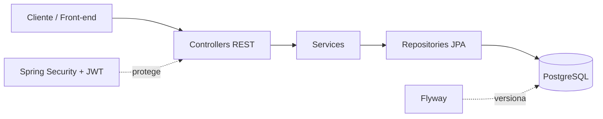
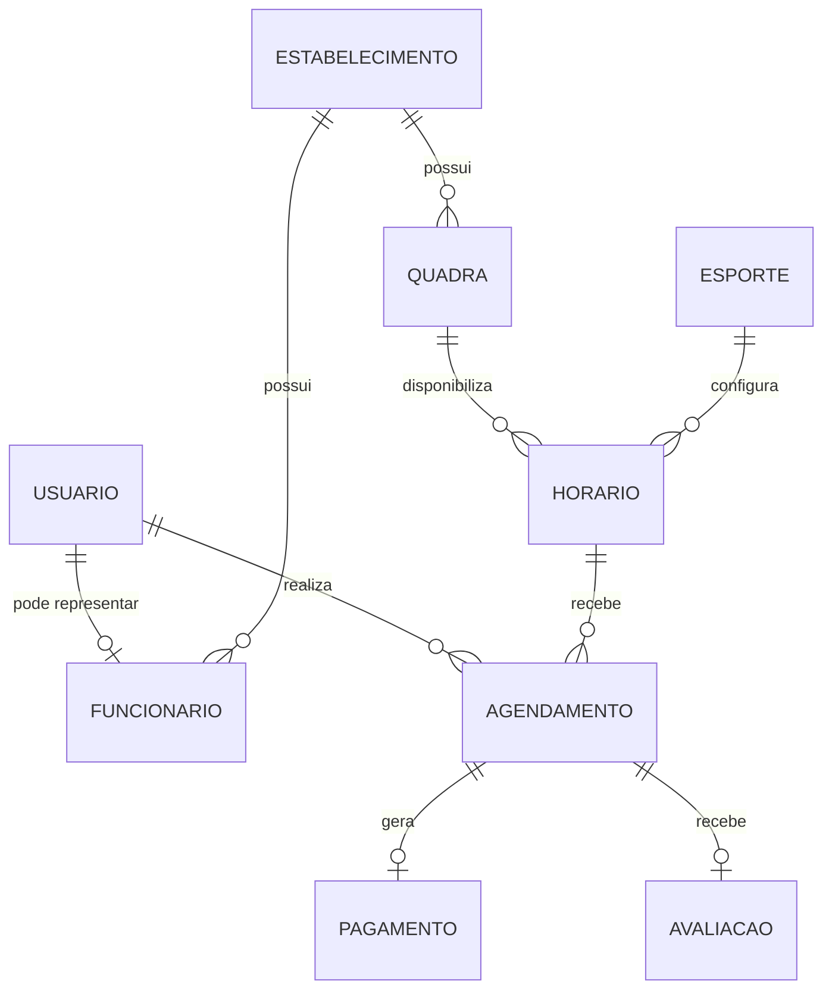

<div align="center">

# ⚽ SportFlow

### Gestão inteligente de espaços esportivos, horários e reservas

API REST para centralizar a operação de estabelecimentos esportivos — do cadastro das quadras à avaliação final do agendamento.

[](https://www.oracle.com/java/technologies/javase/jdk21-archive-downloads.html)
[](https://spring.io/projects/spring-boot)
[](https://www.postgresql.org/)
[](https://maven.apache.org/)
[](https://jwt.io/)

[Sobre](#-sobre-o-projeto) •
[Tecnologias](#-tecnologias) •
[Como executar](#-como-executar) •
[API](#-documentação-da-api) •
[Arquitetura](#-arquitetura)

</div>

---

## 💡 Sobre o projeto

O **SportFlow** é o back-end de uma plataforma de gerenciamento esportivo. A aplicação organiza usuários, estabelecimentos, funcionários, quadras, modalidades e horários, além de controlar o ciclo completo de agendamentos, pagamentos e avaliações.

### Principais recursos

- Cadastro e autenticação de usuários com **JWT**;
- Senhas protegidas com **BCrypt**;
- Gestão de estabelecimentos, funcionários, quadras e esportes;
- Configuração dos horários disponíveis por quadra e modalidade;
- Criação, consulta, atualização e cancelamento de agendamentos;
- Controle de pagamentos e seus diferentes status;
- Avaliação da experiência após o agendamento;
- Versionamento do banco de dados com **Flyway**;
- Documentação interativa com **OpenAPI/Swagger**;
- Tratamento centralizado de exceções;
- Persistência com **Spring Data JPA** e PostgreSQL.

## 🛠️ Tecnologias

| Categoria | Tecnologia |
|---|---|
| Linguagem | Java 21 |
| Framework | Spring Boot 4.1.1 |
| API | Spring Web MVC |
| Segurança | Spring Security, JWT e BCrypt |
| Persistência | Spring Data JPA / Hibernate |
| Banco de dados | PostgreSQL |
| Migrações | Flyway |
| Validação | Jakarta Bean Validation |
| Documentação | Springdoc OpenAPI / Swagger UI |
| Produtividade | Lombok |
| Testes | JUnit, MockMvc e H2 |
| Build | Maven Wrapper |

## 🚀 Como executar

### Pré-requisitos

Antes de começar, instale:

- [Git](https://git-scm.com/);
- [Java JDK 21](https://www.oracle.com/java/technologies/javase/jdk21-archive-downloads.html);
- [PostgreSQL](https://www.postgresql.org/download/).

> O Maven não precisa estar instalado globalmente: o repositório já inclui o Maven Wrapper.

### 1. Clone o repositório

```bash
git clone https://github.com/Hique2605/SportFlow.git
cd SportFlow
```

### 2. Crie o banco de dados

Com o PostgreSQL em execução, crie um banco chamado `sportflow`:

```sql
CREATE DATABASE sportflow;
```

As tabelas e os relacionamentos serão criados automaticamente pelo Flyway na primeira inicialização.

### 3. Configure o ambiente

A aplicação aceita as propriedades do Spring por variáveis de ambiente:

| Variável | Obrigatória | Valor padrão | Descrição |
|---|:---:|---|---|
| `DB_PASSWORD` | Sim | — | Senha do usuário do PostgreSQL |
| `JWT_SECRET` | Recomendado | Configuração local | Chave usada para assinar os tokens JWT |
| `SPRING_DATASOURCE_URL` | Não | `jdbc:postgresql://localhost:5432/sportflow` | URL de conexão com o banco |
| `SPRING_DATASOURCE_USERNAME` | Não | `postgres` | Usuário do PostgreSQL |

No **PowerShell**:

```powershell
$env:DB_PASSWORD = "sua_senha_do_postgres"
$env:JWT_SECRET = "uma-chave-secreta-forte-com-pelo-menos-32-caracteres"
```

No **Linux/macOS**:

```bash
export DB_PASSWORD="sua_senha_do_postgres"
export JWT_SECRET="uma-chave-secreta-forte-com-pelo-menos-32-caracteres"
```

> Em produção, nunca versione credenciais ou reutilize os valores de desenvolvimento.

### 4. Inicie a aplicação

No Windows:

```powershell
.\mvnw.cmd spring-boot:run
```

No Linux/macOS:

```bash
./mvnw spring-boot:run
```

Quando a inicialização terminar, a API estará disponível em:

```text
http://localhost:8080
```

## 📚 Documentação da API

Com o projeto em execução, acesse:

- **Swagger UI:** [http://localhost:8080/swagger-ui.html](http://localhost:8080/swagger-ui.html)
- **OpenAPI JSON:** [http://localhost:8080/v3/api-docs](http://localhost:8080/v3/api-docs)

### Autenticação

As rotas de cadastro, login e documentação são públicas. Todas as demais rotas exigem um token JWT no cabeçalho da requisição:

```http
Authorization: Bearer SEU_TOKEN_JWT
```

#### 1. Cadastre um usuário

```bash
curl --request POST http://localhost:8080/auth/register \
  --header "Content-Type: application/json" \
  --data '{
    "name": "Maria Silva",
    "email": "maria@sportflow.com",
    "password": "uma-senha-segura"
  }'
```

#### 2. Faça login

```bash
curl --request POST http://localhost:8080/auth/login \
  --header "Content-Type: application/json" \
  --data '{
    "email": "maria@sportflow.com",
    "password": "uma-senha-segura"
  }'
```

Resposta esperada:

```json
{
  "token": "eyJhbGciOiJIUzI1NiJ9..."
}
```

Use o token retornado nas próximas requisições. Ele possui validade de **24 horas**.

### Endpoints

| Módulo | Método e rota | Descrição |
|---|---|---|
| Autenticação | `POST /auth/register` | Cadastra um usuário |
| Autenticação | `POST /auth/login` | Autentica e retorna um JWT |
| Usuários | `POST /usuarios` | Cria um usuário |
| Usuários | `GET /usuarios` · `GET /usuarios/{id}` | Lista ou consulta usuários |
| Usuários | `PUT /usuarios/{id}` · `DELETE /usuarios/{id}` | Atualiza ou remove um usuário |
| Estabelecimentos | `POST /api/estabelecimentos` | Cria um estabelecimento |
| Estabelecimentos | `GET /api/estabelecimentos` · `GET /api/estabelecimentos/{id}` | Lista ou consulta estabelecimentos |
| Estabelecimentos | `PUT /api/estabelecimentos/{id}` · `DELETE /api/estabelecimentos/{id}` | Atualiza ou remove um estabelecimento |
| Funcionários | `POST /api/funcionarios` | Cria um funcionário |
| Funcionários | `GET /api/funcionarios` · `GET /api/funcionarios/{id}` | Lista ou consulta funcionários |
| Funcionários | `PUT /api/funcionarios/{id}` · `DELETE /api/funcionarios/{id}` | Atualiza ou remove um funcionário |
| Quadras | `POST /api/quadras` | Cria uma quadra |
| Quadras | `GET /api/quadras` · `GET /api/quadras/{id}` | Lista ou consulta quadras |
| Quadras | `PUT /api/quadras/{id}` · `DELETE /api/quadras/{id}` | Atualiza ou remove uma quadra |
| Esportes | `POST /api/esportes` | Cria uma modalidade esportiva |
| Esportes | `GET /api/esportes` · `GET /api/esportes/{id}` | Lista ou consulta esportes |
| Esportes | `PUT /api/esportes/{id}` · `DELETE /api/esportes/{id}` | Atualiza ou remove um esporte |
| Horários | `POST /api/horarios` | Cria um horário disponível |
| Horários | `GET /api/horarios` · `GET /api/horarios/{id}` | Lista ou consulta horários |
| Horários | `PUT /api/horarios/{id}` · `DELETE /api/horarios/{id}` | Atualiza ou remove um horário |
| Agendamentos | `POST /agendamentos` | Cria um agendamento |
| Agendamentos | `GET /agendamentos` · `GET /agendamentos/{id}` | Lista ou consulta agendamentos |
| Agendamentos | `GET /agendamentos/usuario/{usuarioId}` | Lista os agendamentos de um usuário |
| Agendamentos | `PUT /agendamentos/{id}` | Atualiza um agendamento |
| Agendamentos | `PATCH /agendamentos/{id}/status` | Altera o status |
| Agendamentos | `PATCH /agendamentos/{id}/cancelar` | Cancela um agendamento |
| Agendamentos | `DELETE /agendamentos/{id}` | Remove um agendamento |
| Pagamentos | `POST /pagamentos` | Registra um pagamento |
| Pagamentos | `GET /pagamentos` · `GET /pagamentos/{id}` | Lista ou consulta pagamentos |
| Pagamentos | `GET /pagamentos/agendamento/{agendamentoId}` | Consulta pelo agendamento |
| Pagamentos | `PUT /pagamentos/{id}` | Atualiza um pagamento |
| Pagamentos | `PATCH /pagamentos/{id}/confirmar` | Confirma um pagamento |
| Pagamentos | `PATCH /pagamentos/{id}/cancelar` | Cancela um pagamento |
| Pagamentos | `DELETE /pagamentos/{id}` | Remove um pagamento |
| Avaliações | `POST /avaliacao` | Registra uma avaliação |
| Avaliações | `GET /avaliacao` · `GET /avaliacao/{id}` | Lista ou consulta avaliações |
| Avaliações | `PUT /avaliacao/{id}` · `DELETE /avaliacao/{id}` | Atualiza ou remove uma avaliação |

### Status disponíveis

| Recurso | Status |
|---|---|
| Agendamento | `PENDENTE`, `CONFIRMADO`, `CANCELADO`, `CONCLUIDO` |
| Pagamento | `PENDENTE`, `PAGO`, `CANCELADO`, `ESTORNADO` |

## 🧱 Arquitetura

O projeto segue uma arquitetura em camadas, separando as responsabilidades HTTP, regras de negócio e acesso a dados:



```text
src/
├── main/
│   ├── java/com/example/SportFlow/
│   │   ├── config/       # Segurança, JWT e OpenAPI
│   │   ├── Controller/   # Endpoints REST
│   │   ├── Dto/          # Objetos de entrada e saída
│   │   ├── Entity/       # Entidades JPA
│   │   ├── Enum/         # Status do domínio
│   │   ├── Exception/    # Tratamento global de erros
│   │   ├── Repository/   # Acesso ao banco de dados
│   │   └── Service/      # Regras de negócio
│   └── resources/
│       ├── db/migration/ # Migrações do Flyway
│       └── application.properties
└── test/                 # Testes de contexto e integração
```

### Modelo de domínio



## 📦 Build

Para gerar o arquivo executável da aplicação:

```powershell
.\mvnw.cmd clean package -DskipTests
```

No Linux/macOS, substitua `mvnw.cmd` por `./mvnw`.

O artefato será criado no diretório `target/` e poderá ser executado com:

```bash
java -jar target/SportFlow-0.0.1-SNAPSHOT.jar
```

## 🤝 Como contribuir

1. Faça um fork deste repositório;
2. Crie uma branch para sua alteração: `git checkout -b feature/minha-feature`;
3. Faça o commit: `git commit -m "feat: adiciona minha feature"`;
4. Envie a branch: `git push origin feature/minha-feature`;
5. Abra um Pull Request.

---

<div align="center">

Desenvolvido com dedicação pela equipe **SportFlow**.

</div>
